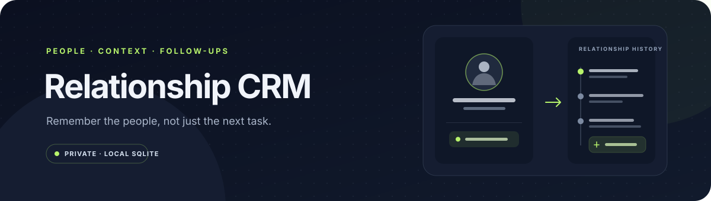
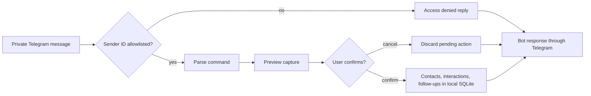

# Relationship CRM



[](https://github.com/jezannn16/relationship-crm/actions/workflows/ci.yml)
[](https://www.python.org/)

**A private, local SQLite CRM with an optional Telegram capture bot.** Track people, interaction history, tags, projects, and follow-ups. The command-line workflow needs no account or network access. Telegram is opt-in and accepts only private messages from configured user IDs.

| | |
|---|---|
| **Storage** | Local SQLite database |
| **CLI** | Available offline, scoped by `--user` |
| **Telegram** | Optional long polling; replies only in the bot chat |
| **Contact messaging** | Not implemented |

## Contents

- [Quick start](#quick-start)
- [Telegram setup](#telegram-setup)
- [How capture works](#how-capture-works)
- [CLI reference](#cli-reference)
- [Privacy and limits](#privacy-and-limits)
- [Development](#development)

## Quick start

Python 3.11 or newer is required. Create an isolated environment:

```sh
python3 -m venv .venv
.venv/bin/python -m pip install -e .
```

Run the synthetic local walkthrough against a temporary database:

```sh
.venv/bin/python app.py --db /tmp/crm-demo.sqlite3 --user demo add 'Anna Example' --email anna@example.test --org ExampleCo
.venv/bin/python app.py --db /tmp/crm-demo.sqlite3 --user demo interaction 1 'Discussed the project timeline'
.venv/bin/python app.py --db /tmp/crm-demo.sqlite3 --user demo followup 1 2026-11-02 'Share the timeline'
.venv/bin/python app.py --db /tmp/crm-demo.sqlite3 --user demo today --date 2026-11-02
.venv/bin/python app.py --db /tmp/crm-demo.sqlite3 --user other search Anna
```

The final search is empty because every CLI query is scoped to its `--user`. The dates and contact are synthetic; use a future or current date to try your own follow-up.

## Telegram setup

The Telegram bot is optional. It needs a bot token from BotFather and your numeric Telegram user ID. Keep the token in a local environment variable or secret manager; do not place it in source, chat, tickets, or GitHub Actions logs. Restrict the bot to your ID with `CRM_ALLOWED_USER_IDS` before starting it.

```sh
export TELEGRAM_BOT_TOKEN='set-this-in-your-local-shell'
export CRM_ALLOWED_USER_IDS='your-numeric-telegram-user-id'
export CRM_TIMEZONE='Europe/Moscow'
.venv/bin/python telegram_bot.py --db /tmp/crm-telegram-test.sqlite3
```

Starting polling connects to Telegram and incoming private messages receive bot replies. For a credential check that does **not** read queued updates or send a message, run this separately before polling:

```sh
.venv/bin/python check_telegram_token.py
```

It calls only Telegram Bot API [`getMe`](https://core.telegram.org/bots/api#getme) and prints the bot username. This checks network access and token validity, not command handling or message delivery. If a token has been exposed, revoke it through BotFather and replace it locally.

The bot's `/capture` flow previews a parsed interaction and follow-up. Confirming writes both to the local CRM. `/add`, `/log`, `/followup`, `/merge`, and `/delete` also change local records; `/confirm` is not a dry-run command.

## How capture works



The bot does not search social networks or message CRM contacts. The only outgoing Telegram messages are responses to the chat that sent a bot command.

## CLI reference

```sh
# Add a contact, record an interaction, and schedule a follow-up.
.venv/bin/python app.py --db crm.sqlite3 --user me add 'Anna Example' --email anna@example.test --org ExampleCo
.venv/bin/python app.py --db crm.sqlite3 --user me interaction 1 'Discussed project status'
.venv/bin/python app.py --db crm.sqlite3 --user me followup 1 2026-11-02 'Send the notes'

# Search, review due items, and export this owner's records.
.venv/bin/python app.py --db crm.sqlite3 --user me search Anna
.venv/bin/python app.py --db crm.sqlite3 --user me today
.venv/bin/python app.py --db crm.sqlite3 --user me export contacts.csv --format csv
```

Dates use `YYYY-MM-DD`; `today` compares due dates against the selected date and does not send reminders. Merge and delete commands require `--confirm`. `delete-user-data --confirm` removes all local CRM records for the chosen owner.

## Privacy and limits

- Contact details, notes, interaction history, and follow-ups are stored in SQLite on this machine. Protect the database, backups, and exports as personal data.
- Telegram polling requests only message updates. It sends an answer to the same chat for accepted private messages, including access-denied responses for non-allowlisted users who message the bot.
- Only numeric IDs in `CRM_ALLOWED_USER_IDS` can use CRM commands. Group messages are ignored. Keep the bot private and configure the allowlist before launch.
- The outbox uses at-most-once delivery. A `failed` or `uncertain` entry may need manual inspection; a retry can duplicate a bot response.
- Reminders appear in `/briefing`; scheduled push notifications, hosted multi-user service, social scraping, and contact messaging are not implemented.

## Development

```sh
.venv/bin/python -m pip install -e '.[dev]'
.venv/bin/python -m unittest discover -v
.venv/bin/ruff check .
```

CI runs local tests and Ruff on Python 3.11 and 3.13. Telegram behavior tests use synthetic updates and a fake API. A separate opt-in `getMe` probe is available for a real token check; CI has no Telegram secrets and does not contact Telegram.

See [docs/demo.md](docs/demo.md) for another synthetic data walkthrough. Run `app.py --help` or `telegram_bot.py --help` for command options.
